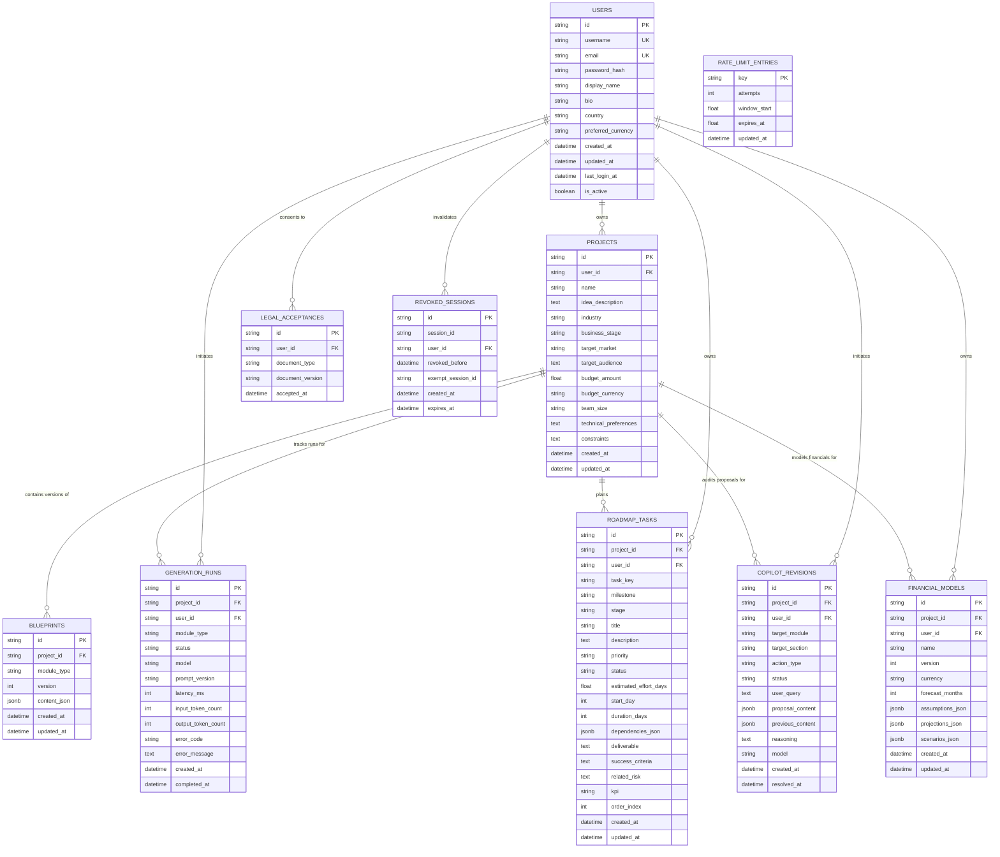

# AI Business Architect — Database Architecture & Schema

The application uses PostgreSQL with SQLAlchemy 2.0 and Alembic for declarative schema management and migrations. In local/testing environments without PostgreSQL credentials, SQLite is supported via engine dialect adaptation.

---

## 1. Entity Relationship Diagram (ERD)



---

## 2. Table Specifications

### 2.1 `users`
- Stores registered user credentials, profile attributes, and security status.
- `username`: Indexed, unique, normalized lowercase (3-30 chars).
- `email`: Indexed, unique, normalized lowercase.
- `password_hash`: Argon2id cryptographic hash (`argon2-cffi`). Plaintext passwords are never stored.
- Cascades deletion to projects, roadmap tasks, financial models, and copilot revisions.

### 2.2 `projects`
- Core entity representing a user's venture or startup concept.
- Foreign key `user_id` references `users.id` with `ON DELETE CASCADE`.
- Indexed on `user_id` for efficient user-scoped queries.

### 2.3 `blueprints`
- Stores versioned JSON outputs of generated and manually edited venture modules.
- `module_type`: Identifies module kind:
  - `business_model`: 9-block Business Model Canvas.
  - `technology_stack`: 5-category architectural recommendation.
  - `validation_report`: AI Idea Validator report (SWOT, risks, experiments, interview questions).
  - `market_research`: Competitor intelligence and verified source citations.
  - `roadmap`: Generated snapshot of execution roadmap tasks.
- `content_json`: PostgreSQL `JSONB` with automatic fallback to generic JSON on non-PostgreSQL dialects.
- Composite unique constraint: `("project_id", "module_type", "version")` ensuring strict version sequence integrity.
- Foreign key `project_id` references `projects.id` with `ON DELETE CASCADE`.

### 2.4 `roadmap_tasks`
- Actionable execution tasks grouped into 30-day, 60-day, and 90-day milestones.
- `task_key`: Human-readable identifier (e.g., `TSK-01`).
- `milestone`: Target execution phase (`30-day`, `60-day`, `90-day`).
- `priority`: Task urgency (`low`, `medium`, `high`, `critical`).
- `status`: Execution state (`not_started`, `in_progress`, `completed`, `blocked`).
- `dependencies_json`: JSON list of prerequisite `task_key`s, validated with 3-color DFS to guarantee a Directed Acyclic Graph (no circular dependencies).
- Foreign keys reference `projects.id` and `users.id` with `ON DELETE CASCADE`.

### 2.5 `copilot_revisions`
- Audit log of AI Copilot interactions, edit proposals, and founder decisions.
- `action_type`: `answer_question` (read-only advisory) or `propose_edit` (structured block modification).
- `status`: `pending`, `accepted`, or `rejected`.
- `proposal_content`: Structured proposed replacement payload.
- `previous_content`: Snapshot of target content before proposal application.
- Foreign keys reference `projects.id` and `users.id` with `ON DELETE CASCADE`.

### 2.6 `financial_models`
- Stores deterministic revenue assumptions, cost structures, and break-even projections.
- Composite unique constraint: `("project_id", "version")`.
- `assumptions_json`: Growth rates, pricing tiers, COGS, and operating expenses.
- `projections_json`: Month-by-month deterministic cash-flow and runway forecast.
- `scenarios_json`: Conservative, Base, and Aggressive scenario projections.

### 2.7 `generation_runs`
- Complete audit ledger of all AI provider invocations (both successful and failed).
- Tracks model identifiers, prompt template versions, execution latency, and token consumption.
- On generation failure, records categorized error codes and safe diagnostic messages without corrupting existing blueprint records.

### 2.8 `legal_acceptances`
- Immutable audit log of user acceptance of Terms and Conditions and Privacy Policy versions upon registration.

### 2.9 `revoked_sessions`
- Server-side session invalidation ledger.
- `session_id`: Specific revoked session UUID (e.g., on logout).
- `revoked_before`: User-level invalidation timestamp (e.g., on password change, invalidating all older sessions while preserving `exempt_session_id`).
- `expires_at`: Clean-up boundary matching session maximum lifespan.

### 2.10 `rate_limit_entries`
- Shared rate-limiting table coordinating sliding-window abuse prevention across multiple web instances without external cache daemons.
- `key`: Composite identifier (e.g., `login:127.0.0.1:alice`, `gen:user-uuid`).

---

## 3. Migration History & Management (Alembic)

Alembic migrations are configured in `backend/alembic.ini` and tracked under `backend/migrations/versions/`.

### Active Migration Chain:
1. **`51b1e8b864ff` (Initial Schema)**:
   - Tables: `users`, `projects`, `blueprints`, `generation_runs`, `legal_acceptances`.
2. **`adf2d38516ac` (V2 Modules Schema)**:
   - Tables: `roadmap_tasks`, `copilot_revisions`, `financial_models`.
   - Additive constraints, foreign keys, and indexes.
3. **`c7b2a1d4e8f3` (Security Hardening Schema)**:
   - Tables: `revoked_sessions`, `rate_limit_entries`.
   - Indexes on expiration timestamps and session keys.

### Applying Migrations:
```bash
# In local development:
python -m alembic -c backend/alembic.ini upgrade head

# In Render production (executed automatically via preDeployCommand):
alembic upgrade head
```

### Creating New Schema Revisions:
```bash
python -m alembic -c backend/alembic.ini revision --autogenerate -m "describe_changes"
```
